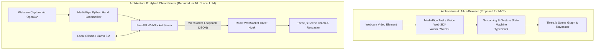
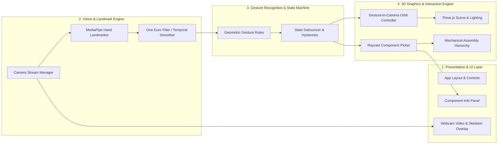
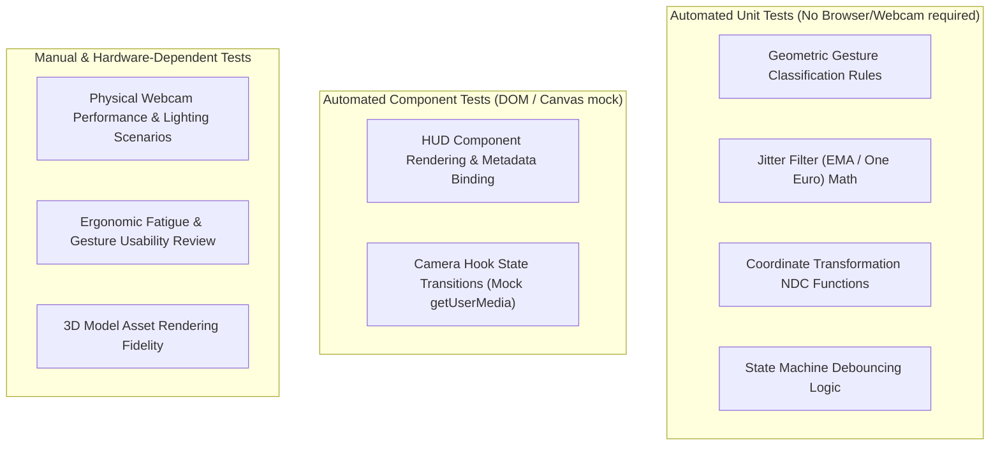
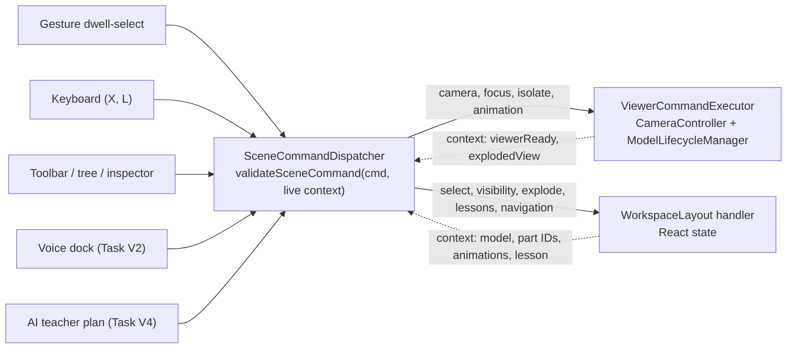
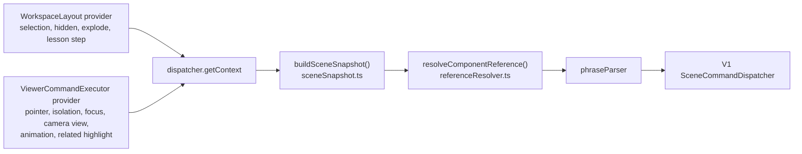
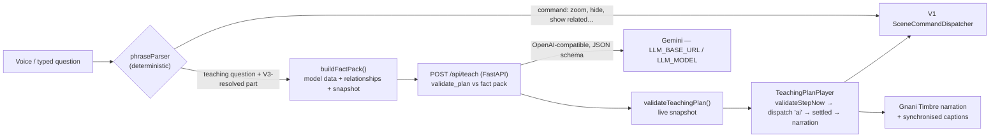

# Architecture Specification: Gesture-Controlled 3D Machine Explorer

---

## 1. Architectural Strategy & Technology Evaluation

A primary architectural decision for this project is determining where the Computer Vision (CV) pipeline executes and whether a separate Python backend is genuinely required for the Minimum Viable Product (MVP).

### 1.1 Architecture Option Comparison



| Factor | Option A: In-Browser (`@mediapipe/tasks-vision`) | Option B: Python Backend + WebSocket |
| :--- | :--- | :--- |
| **System Complexity** | Single process; runs directly in browser via `npm run dev` or static bundle. | Multi-process; requires launching both a Python virtualenv server and a Node/Vite frontend. |
| **Network & IPC Overhead** | **Zero**. Data stays in memory within the browser JavaScript runtime. | Requires JSON serialization/deserialization over loopback WebSocket at 30–60 Hz. |
| **Hardware Acceleration** | Utilizes client GPU via WebGL / WebGPU delegates in WebAssembly. | Utilizes host CPU/GPU via native OpenCV and Python MediaPipe binaries. |
| **User Friction** | Zero-install; user visits URL and allows camera access. | User must install Python 3.10+, pip dependencies, configure ports, and manage two terminals. |
| **Custom ML & Offline Training** | In-browser model training is cumbersome; inference requires ONNX Runtime Web or TensorFlow.js. | **Ideal for Phase 7**: Python has rich data science tools (NumPy, pandas, scikit-learn, PyTorch). |
| **Local LLM Integration** | Browser cannot directly run a 3B+ parameter LLM locally without WebGPU support; needs bridge to Ollama. | **Ideal for Phase 8**: Python easily connects to local Ollama (`http://localhost:11434`) via REST/OpenAI SDK. |

### 1.2 Proposed Architecture Decision for MVP

> [!IMPORTANT]
> **Proposed Architectural Path**:
> - For **Phases 1–5 (MVP)**, we propose utilizing **Option A (Browser-First Pipeline)** using MediaPipe's official Web SDK (`@mediapipe/tasks-vision`). This eliminates unnecessary network serialization, removes multi-process failure points, avoids port contention on Windows, and delivers the lowest friction user experience.
> - The application layer is decoupled through a **unified `GestureStreamProvider` interface**. The 3D scene and gesture controller consume standardized gesture events regardless of whether they originate from the in-browser Web SDK or an external WebSocket stream.
> - **Option B (Python Backend & Experiment Sandbox)** will be utilized for **Phase 7 (Custom ML Classifier Experiments)** and **Phase 8 (Local LLM Integration)**, where Python's data science ecosystem and Ollama client are genuinely required.

---

## 2. Proposed Module Responsibilities



### Module Breakdown:

1. **Camera Stream Manager (`src/services/camera/`)**:
   - Manages `navigator.mediaDevices.getUserMedia` lifecycle.
   - Monitors device status: `IDLE`, `REQUESTING_PERMISSION`, `STREAMING`, `PERMISSION_DENIED`, `DEVICE_NOT_FOUND`.
   - Handles horizontal mirroring and resolution negotiation ($640\times480$ or $1280\times720$).

2. **Landmark Engine (`src/services/tracking/`)**:
   - Initializes MediaPipe `HandLandmarker` using GPU/Wasm delegate.
   - Processes video frames at $\sim 30\text{ FPS}$ returning 21 normalized landmarks $(x, y, z)$ plus world coordinates.
   - Passes coordinates through a temporal smoothing filter (Exponential Moving Average or One Euro Filter) to dampen hand tremors while maintaining low latency.

3. **Gesture Recognition Engine (`src/services/gestures/`)**:
   - Pure, deterministic classification logic operating on normalized landmarks.
   - Computes geometric relationships:
     - *Pinch Distance*: Euclidean distance between Landmark 4 (Thumb Tip) and Landmark 8 (Index Tip).
     - *Finger Extension*: Distance from fingertip to wrist (Landmark 0) compared against intermediate MCP/PIP joints.
     - *Palm Orientation*: Normal vector derived from cross-product $(\vec{v}_{0 \to 5} \times \vec{v}_{0 \to 17})$.
   - Implements temporal debouncing: a new gesture must persist for $\ge 3$ consecutive frames before changing state.

4. **3D Scene & Interaction Engine (`src/components/scene/`)**:
   - Renders the mechanical model with physically based materials (PBR) and soft directional lighting.
   - Translates confirmed gesture events into scene actions:
     - `OPEN_PALM` $\Delta(x, y) \implies$ Orbit rotation around model center.
     - `PINCH` delta $\implies$ Camera dolly (zoom in/out).
     - `POINTING` cursor $(x, y) \implies$ Screen-space raycasting to highlight hovered part.
     - `PINCH` or dwell while pointing $\implies$ Select component and open info panel.
   - Provides concurrent mouse/keyboard fallback controls (`OrbitControls`).

5. **Component Metadata & HUD (`src/components/hud/`)**:
   - Renders technical specifications (part name, mechanical function, material, rotational constraints).
   - Displays real-time telemetry (render FPS, tracking FPS, active gesture, confidence score).

---

## 3. Data Flow & Event Interfaces

### 3.1 Standardized Gesture Event Interface

```typescript
export type GestureType = 'NONE' | 'OPEN_PALM' | 'POINTING' | 'PINCH' | 'FIST';

export interface HandLandmark {
  id: number;     // 0 to 20
  x: number;      // Normalized 0.0 to 1.0 (mirrored)
  y: number;      // Normalized 0.0 to 1.0
  z: number;      // Relative depth to wrist
}

export interface GestureEvent {
  timestamp: number;
  handDetected: boolean;
  handedness: 'Left' | 'Right' | 'Unknown';
  gesture: GestureType;
  confidence: number;
  cursor: {
    x: number;    // Normalized device coordinates (-1.0 to 1.0)
    y: number;
    depth: number;
  };
  pinchDistance: number | null; // Normalized distance (0.0 to 1.0)
  landmarks: HandLandmark[];
}
```

### 3.2 Step-by-Step Processing Flow

```
1. Video Capture: <video> element receives webcam stream at 30-60 Hz.
2. Inference: HandLandmarker.detectForVideo(video, timestamp) -> raw 21 landmarks.
3. Filtering: Low-pass filter dampens jitter: x_smoothed = alpha * x_raw + (1 - alpha) * x_prev.
4. Gesture Classification: Pure function evaluateGesture(landmarks) -> candidate gesture.
5. State Debounce: GestureStateMachine requires candidate to persist for N frames -> active gesture.
6. Event Dispatch: Callback onGesture(gestureEvent) fires to Three.js interaction hook.
7. Matrix Transform:
   - If OPEN_PALM: camera.theta += dx * sensitivity; camera.phi += dy * sensitivity.
   - If POINTING: raycaster.setFromCamera(cursorNDC, camera); check intersections.
   - If PINCH: camera.distance += dPinch * zoomSensitivity.
8. Render Loop: Three.js render(scene, camera) executes at screen refresh rate (60 Hz).
```

---

## 4. Coordinate Transformations

Aligning video pixels to 3D world space involves three distinct coordinate frames:

```
[Webcam Frame Space]
(0, 0) top-left  ───────► (W, H) bottom-right
        │
        ▼ (Horizontal Mirror: x_mirrored = 1.0 - x_raw)
[Normalized Landmark Space]
(0.0, 0.0) top-left ───► (1.0, 1.0) bottom-right
        │
        ▼ (NDC Transform)
[Normalized Device Coordinates (NDC) for Three.js]
(-1.0, 1.0) top-left ──► (1.0, -1.0) bottom-right, (0, 0) center
        │
        ▼ (Raycaster.setFromCamera)
[3D World Space]
(X, Y, Z) Euclidean space (meters / units)
```

### Transformation Equations:
$$x_{\text{mirrored}} = 1.0 - x_{\text{raw}}$$
$$x_{\text{ndc}} = (x_{\text{mirrored}} \times 2.0) - 1.0$$
$$y_{\text{ndc}} = -( (y_{\text{raw}} \times 2.0) - 1.0 )$$

---

## 5. Error Handling & Fallback Behavior

| Failure Mode | Detection Condition | Fallback Action | User Feedback |
| :--- | :--- | :--- | :--- |
| **Camera Permission Denied** | `navigator.mediaDevices.getUserMedia` throws `NotAllowedError` | Fall back completely to mouse and keyboard controls. | Display non-blocking banner: "Camera access denied. Explore using mouse/keyboard." |
| **No Camera Connected** | `NotFoundError` or empty device list | Fall back completely to mouse controls. | Display banner: "No webcam detected. Mouse controls active." |
| **Hand Leaves Frame** | `landmarks.length === 0` | Maintain last camera orientation; apply smooth inertia deceleration. | HUD displays "No hand detected. Raise hand to interact." |
| **Ambiguous / Rapid Transition** | Gesture confidence $< 0.70$ or transitioning | Maintain previous steady state; do not trigger false clicks. | HUD gesture indicator shows neutral state. |
| **WebGL Context Lost** | `webglcontextlost` event fired on canvas | Pause render loop; attempt canvas restore or alert user to reload. | Display recovery prompt: "Graphics context lost. Attempting reload..." |

---

## 6. Testing Boundaries



---

## 7. Performance Targets vs. Assumptions

> [!NOTE]
> All metrics below are **proposed targets** for implementation and benchmarking:

- **Target Render FPS**: $\ge 60\text{ FPS}$ on standard integrated GPUs.
- **Target Tracking FPS**: $\ge 30\text{ FPS}$ via MediaPipe WebAssembly GPU delegate.
- **Target Response Latency**: $< 100\text{ ms}$ glass-to-mesh response time.
- **Assumed Hardware Baseline**: Quad-core Intel Core i5 / AMD Ryzen 5 or Apple Silicon M1, 8GB RAM, integrated graphics, standard $720\text{p}$ USB/internal webcam.

---

## 8. Unified Scene Command Channel (Phase 11 — Task V1)

All input methods operate the workspace through **one validated command interface**. Continuous hand motion (open-palm orbit, pinch zoom) still drives the camera directly every frame for low latency; every *discrete* operation — and every operation coming from voice or the AI teacher — is a `SceneCommand`.



**Files**: `src/services/commands/sceneCommands.ts` (vocabulary + validator), `sceneCommandDispatcher.ts` (routing, history, listeners), `viewerCommandExecutor.ts` (viewer execution + arbitration).

**Validation (never trust the caller)** — input is `unknown`; the validator checks shape and ranges, strips unknown fields, and rejects with a code and reason when a component ID is not in the *currently loaded* model, an animation is not declared by the model (`EngineeringModelDefinition.animations`), the model has no exploded view, no lesson is running, or a model is not registered. The LLM will only ever produce these data commands — never code or Three.js object references.

**Arbitration (the user always wins)**:
| Situation | Behaviour |
| :--- | :--- |
| Camera command while a hand gesture or mouse drag steers the camera | Deferred; latest replaces earlier; runs on release; expires after 2.5 s |
| Hand/mouse starts while a command transition is animating | Transition cancelled that frame; camera stays where the user took it |
| Instant preset key/button during a transition | Transition cancelled; preset applied |
| Non-camera command (isolate, animation, select…) during gesture | Executes immediately |

**Camera transitions**: `CameraController.animateTo` interpolates target linearly and the camera in spherical coordinates around it (arcs around the model, shortest way), 350 ms ease-in-out, clamped to distance/elevation limits; auto-orbit is suspended during the move and restored to the user's intent. Views: isometric, top, front (fixed presets) and back, left, right (keep current target and distance). Bottom is unsupported by design (camera constrained above the ground grid).

**Order inside the render loop**: model animation (`speed × delta`) → gesture camera update → `commandExecutor.tick()` (cancel / flush / expire) → `cameraController.update(now)` (steps transition, damping, auto-orbit) → render.

**Development hook**: in `npm run dev` only, `window.__sceneCommands.dispatch({ type: 'camera.view', view: 'back' })`, `.context()`, `.history()`.

**Known gaps (next tasks)**: multi-component highlighting, component relationship data (type exists, unpopulated), scene snapshot/deixis ("this part"), voice input/output, AI teaching plans.

## 9. Multilingual Voice Control (Phase 11 — Task V2)

```mermaid
flowchart LR
    Mic["VoiceDock mic<br/>recorder.ts: 16 kHz WAV"] -->|POST /api/voice/transcribe| B["FastAPI backend<br/>(holds GNANI_API_KEY)"]
    B -->|stt/v3| P[Gnani Prisma]
    B -->|transcript| Parse["phraseParser.ts<br/>+ partLexicon from loaded model"]
    Parse -->|SceneCommand[] source 'voice'| D[V1 SceneCommandDispatcher]
    D --> Rep["voiceReplies.ts caption"]
    Rep -->|problems, or all if toggled| T["POST /api/voice/speak → Gnani Timbre"]
```

**Backend** (`backend/app`): `GET /api/voice/health`, `POST /api/voice/transcribe` (WAV, ≤2 MB, 0.2–30 s), `POST /api/voice/speak` (≤400 chars). Errors: `{"error": {"code", "message"}}`. The key never leaves the server and is never logged. Start: `cd backend && python -m uvicorn app.main:app --port 8000`; Vite proxies `/api` there (`VOICE_BACKEND_URL` overrides).

**Parsing**: deterministic; no LLM. Part names come from the loaded model, so a new model gets voice names automatically. Matching for Indic scripts is word-start based (suffixes like -ని / -को allowed); nukta and zero-width joiners are normalised. Parts of other models / common machine parts are recognised only to reject them by name.

**Languages**: en-IN, te-IN, hi-IN fully supported (grammar + replies, incl. code-mixed). ta, kn, ml, bn, mr, gu, pa are **beta**: Prisma/Timbre work, but commands need English words and replies are English.

**Safety & arbitration**: every voice command goes through V1 validation; a rejected step stops the turn. Camera commands are deferred while a hand or mouse steers (dock shows "waiting", then "done" or "expired"). Cancel bumps a turn counter, aborts requests and playback, so stale transcripts never execute.

**Development hook**: `window.__voiceDock.say(text)`, `.submitAudio(wavBlob)`, `.setLanguage(code)` (dev builds only).

## 10. Scene Snapshot & Context-Aware Part Resolution (Phase 11 — Task V3)

No new state store: the snapshot is assembled on demand from the dispatcher's existing context providers, which now also report typed facts.



**Snapshot schema** (`src/services/scene/sceneSnapshot.ts`, `version: 1`): `model` {id, name, domain, category} | null; `components[]` {id, name, role, visible, relatedComponentIds}; `selectedComponentId`; `pointer` Fact<{componentId, source: mouse|gesture}>; `focusedComponentId` Fact; `hiddenComponentIds`; `isolatedComponentId` Fact; `highlightedComponentIds` Fact; `exploded` {supported, factor, active}; `camera` Fact<{view: isometric|top|front|back|left|right|custom, autoOrbit, transitioning, userSteering}>; `animation` {available[], state Fact<{playing, speed}>}; `lesson` {available, active, stepCount, currentStep, stepTitle, stepComponentId}; `lastDiscussedComponentId` Fact; `availableActions[]`.
`Fact<T>` = `{status:'known', value}` or `{status:'unavailable', reason}`: "nothing hovered" (`known null`) is distinct from "viewer not mounted" (`unavailable`). Every ID is filtered against the loaded model's component list, so stale IDs from a previous model never appear. Only IDs, names and states: no geometry, Three.js objects or credentials (~2.5 KB for the gearbox). Dev hook: `window.__sceneCommands.snapshot()`.

**Live sources**: pointer = the same raycast result that drives the hover glow (`ComponentSelector.hoveredId`, mouse or hand laser pointer), cleared when the pointer leaves the canvas; camera view = `CameraController.classifyView()` (actual viewing direction within 10°, so it is never stale after manual orbiting); focus = last `component.focus`, cleared by any other camera motion or user steering; workspace facts update with React state on the next render.

**Reference resolution** (`referenceResolver.ts`, deterministic): explicit name/alias → pointed (hover/laser) → selected → last discussed (same model) → ask the user. Several explicit matches → "which one?". Implicit candidates must belong to the loaded model. The resolver only names a component; commands still go through V1 validation. Conversation memory ("last discussed") lives in the VoiceDock (a ref, per model), not in global state.

**Relationships**: stored in each model's metadata (`ComponentRelationship`, the existing type and inspector section) from explicit edge tables with evidence (`models/mechanical/planetaryGearboxRelationships.ts`, `models/civil/warrenTrussRelationships.ts`); inverses are generated (`drives`/`driven_by`, `supports`/`supported_by`, `mates_with`, `connected_to`, `fastened_to`, `transfers_force_to`/`receives_force_from`). Queries: `getComponentRelationships`, `getRelatedComponentIds(types?)`, `getNeighbourhood(depth)`, `validateModelRelationships` (`services/scene/componentRelationships.ts`).

**Highlighting**: new V1 commands `component.highlight {componentIds ≤ 20}` / `component.clearHighlight` (viewer handler). `ComponentRaycaster` gained a third, lowest-priority layer (selection amber > hover cyan > related green); clearing restores each part's previous highlight or original material. A model switch creates a new raycaster, so highlights never leak across models.

**Voice**: new outcomes: `question` (identify/explain/howWorks/purpose/failure; only "what is this?" is answered, from metadata name + role; the rest return the resolved part and "not available yet"), `unavailable` (no recorded relationships, nothing to put back), contextual "put it back" (un-isolate → unhide → reassemble → clear highlight), "show the parts connected to it", "clear the highlight".

## 11. AI Teaching Engine (Phase 11 — Task V4)

Questions are answered with a grounded explanation, validated scene actions and Gnani narration, all on the currently loaded model. The LLM only produces a plan (data); the app validates and runs it through the V1 dispatcher.



**Provider**: `backend/app/llm.py` — any OpenAI-compatible endpoint, configured by `LLM_BASE_URL`, `LLM_MODEL`, `LLM_API_KEY`, resolved by `app/config.py` in this order: process environment → `backend/.env` → project-root `.env` (paths derived from the code location, independent of the working directory; empty values count as missing; only names/sources are ever reported); the project targets Google Gemini (`https://generativelanguage.googleapis.com/v1beta/openai/`, structured output via `response_format: json_schema`). The key is only sent in the Authorization header to that endpoint. `/api/voice/health` reports `teaching.configured` (booleans + model id). `backend/scripts/check_llm.py` verifies the endpoint, model availability and one real plan.

**Routing (explicit, tested)**: deterministic commands (zoom, views, select/hide/isolate, "show the parts connected to…", put back, "what is this?") never reach the LLM. Teaching questions = explain / how / why / what-if-fails / power-flow / load-path / "what happens when…". Part references are resolved by the V3 resolver before the request ("this/it" → pointed, selected, last discussed; else "which part?"). Whole-model questions ("how does this gearbox work", "from the deck to the piers") have no target. If the teaching model is not configured, questions keep the V3 "not available yet" reply.

**Fact pack** (`services/teaching/factPack.ts`): model id/name/domain; every part's id, name, role and validated relationships; full description, notes and specifications only for the target and its direct neighbours (all parts for whole-model questions); declared animations; teachable actions available now; scene state; explicit limits ("animation is a kinematic visual demonstration, not a force/torque simulation", "no structural analysis/FEA", "failures cannot be simulated", "only listed relationships are known"). ~3–6 KB. Conversation history (≤ 3 turns: question, target, plan title) is sent separately and only helps with follow-ups.

**Teaching-plan schema v1** (backend `teaching.py` = frontend `teachingPlan.ts`): `schemaVersion, planId (server), modelId (server, from the fact pack), targetComponentId, title ≤120, explanation ≤1200, cannotAnswer, steps[1–8], rejectedSteps[], followUpSuggestions ≤3`. Step: `index, kind (demonstrate|explain), claim (visible|metadata|engineering|notSimulated), narration ≤350, caption ≤120, targetComponentId, actions[≤3], waitFor (narration|user), holdMs 0–4000`. Actions are V1 commands limited to: `component.select/focus/highlight/clearHighlight/isolate, assembly.explode/restore, animation.play/pause/setSpeed, camera.view/reset` (no hiding, model switching, navigation, lessons).

**Validation (3 layers)**: (1) backend vs fact pack — unknown commands, parts, animations, explode support, allowed actions, ranges, text length, code/markup/URL patterns; an invalid step is rejected and listed, never rewritten; a plan with no valid step, > 8 steps or an unsafe title/explanation is rejected; the LLM cannot set `modelId`. (2) Browser vs live snapshot when the plan arrives (stale model → refused). (3) `validateStepNow` immediately before each step (V1 `validateSceneCommand` + model id). Prompt injection: the question and model text are delimited as data; the system prompt is fixed; whatever comes back passes the same validation.

**Player policies** (`services/teaching/planPlayer.ts`): one plan at a time (a new question cancels the old plan first). Per step: actions → wait for `camera.settled` (no transition, no deferred command; new `pendingCommand` viewer fact) → narration, ending on the audio's real `ended` event (next step's audio prefetched; TTS requests serialised with one retry on Gnani 429; if speech fails the caption stays for a reading-time fallback) → optional hold → optional Continue. Manual takeover (any non-'ai' command, or the user steering the camera) pauses; speaking to the mic pauses (the mic never records narration); a model switch cancels without restoring; stale replies (newer question, Cancel, model switch) are discarded. Restoration on finish/cancel: highlight, isolation, exploded view and animation play state/speed return to their pre-plan values; selection is restored on cancel only; the camera is left where it is (Reset view restores it).

**Not claimed**: the gearbox animation is kinematic (fixed ratios), not a force/torque/friction simulation; the bridge has no structural analysis; failure answers are labelled engineering reasoning ("Not simulated in this app").

**Gnani as the teaching LLM (checked 27 Oct 2026)**: not possible with the public API. Gnani's docs expose speech (Prisma), TTS (Timbre), voice cloning and the Agent Builder platform (`https://api.inya.ai/platform`, `x-api-key`). The only LLM-related endpoint, `GET /v1/agents/config/llm_models`, lists models for configuring voice agents; there is no completion/chat/inference endpoint, no OpenAI-compatible surface and no structured-output mode. Evon v3.3 is open weights (Hugging Face), usable only via self-hosting or a third-party host.

## 12. Reliable Voice Interaction (Phase 11 — Task V5)

**Request classification** (`phraseParser.ts` → `voiceSession.ts`), one result per accepted turn:

| Kind | Examples | Effect on a playing explanation |
| :--- | :--- | :--- |
| Teaching question (new or follow-up) | "Explain this part", "Why is it needed?", "ఈ పార్ట్ ని ఎక్స్ప్లెయిన్ చెయ్యి", "इसे एक्सप्लेन करो" | superseded by the new plan (follow-ups keep the part via V3 resolution) |
| Correction | "No, not that part. Explain the planet carrier instead." | superseded; the explicit name wins |
| Scene command | "Just show me where it is", "zoom in" | superseded (cancel + restore), then the command runs |
| Explanation control (only while one is active) | "wait / continue / stop", "ఆగు / కొనసాగించు / చాలు", "रुको / जारी रखो / बस" | pause / resume / stop |
| Clarification / unknown / empty | "Which part?", "explain the piston", silence | not a new request: the explanation stays paused, the user answers or says "continue" |

Push-to-talk is the barge-in signal: pressing the mic pauses narration at once (the mic never records the agent's own voice); if nothing was said the explanation resumes. Language: "explain it in Telugu" switches the conversation language; the plan's narration language is fixed when it is requested.

**Request lifecycle** (`services/teaching/teachingController.ts`, framework-free): every teaching request has a token; `ask()` aborts the previous fetch and cancels the playing plan; a reply is played only if its token is still current and the model unchanged; `supersede()` / `cancel()` / `modelChanged()` invalidate pending work. The player re-checks liveness before every scene action and re-validates each step; the narrator never creates audio for a stopped clip and never requests TTS for a cancelled queued clip.

**Always an answer**: if the AI teacher cannot answer (not configured, quota, provider/network error, invalid plan), `componentBrief.ts` builds a grounded explanation from the model data only — identity and role, description, validated relationships (with highlighting), engineering notes, and an explicit "not simulated" step — which goes through the same validation and player, with a clear notice. Confirmations are spoken by default.

**Explanation framework (AI teacher)**: the backend prompt asks, in order and only as far as FACTS support, for identity, purpose, operation, interactions (inputs/outputs from relationships), system role (`modelDescription`), what is visible now, and what is not simulated; `questionType` (explain / howWorks / purpose / failure) focuses it; calm, conversational style with English technical terms inside Telugu/Hindi.

**RAG decision (V5)**: not introduced. The loaded model's structured facts (≤ 9 parts, notes, specifications, validated relationships) fit in one ~3–6 KB fact pack and are retrieved deterministically; the observed failures were routing, lifecycle and fallback problems, not missing knowledge. Revisit only for a demonstrated gap (e.g. operation/failure content per component), starting with curated, per-component structured fields before any document index.

## 13. Voice-First Interaction (voice-first milestone)

**Turn pipeline**: recording → Prisma in the selected language → if not understood, the SAME recording is re-transcribed in the other conversation languages (te/hi/en) and the understood version wins (`voiceLanguage.ts`; measured: Telugu/Hindi sent as en-IN come back romanised, English sent as te/hi comes back transliterated) → deterministic parser → if still not understood, `/api/interpret` (LLM, one intent from a fixed list + a part id from the loaded model) → canonical phrase → the SAME parser and validated dispatcher. The LLM never produces actions.

**Language**: the reply/teaching language is the language of the latest request (script of the transcript, or the language the retry understood), and the selector follows it; "explain it in Telugu" overrides. Model-data fallbacks are English and say so.

**Interruption policy**: teaching questions, corrections and part commands supersede the explanation (cancel + restore); camera-only commands (zoom, turn, move, views, reset) run and PAUSE it, so a paused plan cannot undo them and "continue" (any of en/te/hi) resumes; clarifications, unknown speech and "no bottom view" leave it as is. Push-to-talk (mic button or M) pauses narration at once, so the agent never hears itself.

**Navigation by voice** (shared dispatcher, smooth transitions, a new command supersedes a running transition): zoom in/out, turn left/right/up/down (orbit), move left/right/up/down (pan), front/back/top/left/right/isometric views, reset, focus on this/named part ("zoom in on this gear" focuses the part). Bottom view is not available (camera kept above the ground grid since V1) and is answered clearly; moving parts is not supported.

**Teaching style**: the prompt adds an optional everyday analogy (bicycle gears, an axle, a bearing, a bridge you have walked on…) followed by where it matches and where it differs, beginner-friendly but accurate.

**UI**: Voice tutor dock with explicit states (listening, understanding, preparing, explaining step x/y, paused, speaking, error — each with a text/icon label), topic chip, always-visible Stop, example phrases, M shortcut; inspector "Ask the tutor" (Explain / Why is it needed? / How does it work? / What if it fails?) and a tutor card when nothing is selected; webcam panel compact until the camera starts and placed above the viewport toolbar; docks start collapsed at ≤ 1024 px; hierarchy names wrap to two lines.

