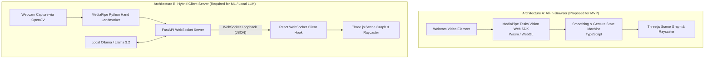
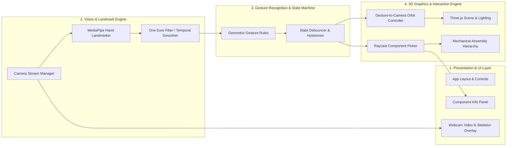
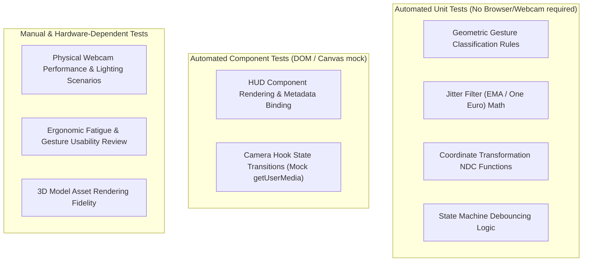

# Architecture Specification: Gesture-Controlled 3D Machine Explorer

---

## 1. Architectural Strategy & Technology Evaluation

A primary architectural decision for this project is determining where the Computer Vision (CV) pipeline executes and whether a separate Python backend is genuinely required for the Minimum Viable Product (MVP).

### 1.1 Architecture Option Comparison



| Factor | Option A: In-Browser (`@mediapipe/tasks-vision`) | Option B: Python Backend + WebSocket |
| :--- | :--- | :--- |
| **System Complexity** | Single process; runs directly in browser via `npm run dev` or static bundle. | Multi-process; requires launching both a Python virtualenv server and a Node/Vite frontend. |
| **Network & IPC Overhead** | **Zero**. Data stays in memory within the browser JavaScript runtime. | Requires JSON serialization/deserialization over loopback WebSocket at 30–60 Hz. |
| **Hardware Acceleration** | Utilizes client GPU via WebGL / WebGPU delegates in WebAssembly. | Utilizes host CPU/GPU via native OpenCV and Python MediaPipe binaries. |
| **User Friction** | Zero-install; user visits URL and allows camera access. | User must install Python 3.10+, pip dependencies, configure ports, and manage two terminals. |
| **Custom ML & Offline Training** | In-browser model training is cumbersome; inference requires ONNX Runtime Web or TensorFlow.js. | **Ideal for Phase 7**: Python has rich data science tools (NumPy, pandas, scikit-learn, PyTorch). |
| **Local LLM Integration** | Browser cannot directly run a 3B+ parameter LLM locally without WebGPU support; needs bridge to Ollama. | **Ideal for Phase 8**: Python easily connects to local Ollama (`http://localhost:11434`) via REST/OpenAI SDK. |

### 1.2 Proposed Architecture Decision for MVP

> [!IMPORTANT]
> **Proposed Architectural Path**:
> - For **Phases 1–5 (MVP)**, we propose utilizing **Option A (Browser-First Pipeline)** using MediaPipe's official Web SDK (`@mediapipe/tasks-vision`). This eliminates unnecessary network serialization, removes multi-process failure points, avoids port contention on Windows, and delivers the lowest friction user experience.
> - The application layer is decoupled through a **unified `GestureStreamProvider` interface**. The 3D scene and gesture controller consume standardized gesture events regardless of whether they originate from the in-browser Web SDK or an external WebSocket stream.
> - **Option B (Python Backend & Experiment Sandbox)** will be utilized for **Phase 7 (Custom ML Classifier Experiments)** and **Phase 8 (Local LLM Integration)**, where Python's data science ecosystem and Ollama client are genuinely required.

---

## 2. Proposed Module Responsibilities



### Module Breakdown:

1. **Camera Stream Manager (`src/services/camera/`)**:
   - Manages `navigator.mediaDevices.getUserMedia` lifecycle.
   - Monitors device status: `IDLE`, `REQUESTING_PERMISSION`, `STREAMING`, `PERMISSION_DENIED`, `DEVICE_NOT_FOUND`.
   - Handles horizontal mirroring and resolution negotiation ($640\times480$ or $1280\times720$).

2. **Landmark Engine (`src/services/tracking/`)**:
   - Initializes MediaPipe `HandLandmarker` using GPU/Wasm delegate.
   - Processes video frames at $\sim 30\text{ FPS}$ returning 21 normalized landmarks $(x, y, z)$ plus world coordinates.
   - Passes coordinates through a temporal smoothing filter (Exponential Moving Average or One Euro Filter) to dampen hand tremors while maintaining low latency.

3. **Gesture Recognition Engine (`src/services/gestures/`)**:
   - Pure, deterministic classification logic operating on normalized landmarks.
   - Computes geometric relationships:
     - *Pinch Distance*: Euclidean distance between Landmark 4 (Thumb Tip) and Landmark 8 (Index Tip).
     - *Finger Extension*: Distance from fingertip to wrist (Landmark 0) compared against intermediate MCP/PIP joints.
     - *Palm Orientation*: Normal vector derived from cross-product $(\vec{v}_{0 \to 5} \times \vec{v}_{0 \to 17})$.
   - Implements temporal debouncing: a new gesture must persist for $\ge 3$ consecutive frames before changing state.

4. **3D Scene & Interaction Engine (`src/components/scene/`)**:
   - Renders the mechanical model with physically based materials (PBR) and soft directional lighting.
   - Translates confirmed gesture events into scene actions:
     - `OPEN_PALM` $\Delta(x, y) \implies$ Orbit rotation around model center.
     - `PINCH` delta $\implies$ Camera dolly (zoom in/out).
     - `POINTING` cursor $(x, y) \implies$ Screen-space raycasting to highlight hovered part.
     - `PINCH` or dwell while pointing $\implies$ Select component and open info panel.
   - Provides concurrent mouse/keyboard fallback controls (`OrbitControls`).

5. **Component Metadata & HUD (`src/components/hud/`)**:
   - Renders technical specifications (part name, mechanical function, material, rotational constraints).
   - Displays real-time telemetry (render FPS, tracking FPS, active gesture, confidence score).

---

## 3. Data Flow & Event Interfaces

### 3.1 Standardized Gesture Event Interface

```typescript
export type GestureType = 'NONE' | 'OPEN_PALM' | 'POINTING' | 'PINCH' | 'FIST';

export interface HandLandmark {
  id: number;     // 0 to 20
  x: number;      // Normalized 0.0 to 1.0 (mirrored)
  y: number;      // Normalized 0.0 to 1.0
  z: number;      // Relative depth to wrist
}

export interface GestureEvent {
  timestamp: number;
  handDetected: boolean;
  handedness: 'Left' | 'Right' | 'Unknown';
  gesture: GestureType;
  confidence: number;
  cursor: {
    x: number;    // Normalized device coordinates (-1.0 to 1.0)
    y: number;
    depth: number;
  };
  pinchDistance: number | null; // Normalized distance (0.0 to 1.0)
  landmarks: HandLandmark[];
}
```

### 3.2 Step-by-Step Processing Flow

```
1. Video Capture: <video> element receives webcam stream at 30-60 Hz.
2. Inference: HandLandmarker.detectForVideo(video, timestamp) -> raw 21 landmarks.
3. Filtering: Low-pass filter dampens jitter: x_smoothed = alpha * x_raw + (1 - alpha) * x_prev.
4. Gesture Classification: Pure function evaluateGesture(landmarks) -> candidate gesture.
5. State Debounce: GestureStateMachine requires candidate to persist for N frames -> active gesture.
6. Event Dispatch: Callback onGesture(gestureEvent) fires to Three.js interaction hook.
7. Matrix Transform:
   - If OPEN_PALM: camera.theta += dx * sensitivity; camera.phi += dy * sensitivity.
   - If POINTING: raycaster.setFromCamera(cursorNDC, camera); check intersections.
   - If PINCH: camera.distance += dPinch * zoomSensitivity.
8. Render Loop: Three.js render(scene, camera) executes at screen refresh rate (60 Hz).
```

---

## 4. Coordinate Transformations

Aligning video pixels to 3D world space involves three distinct coordinate frames:

```
[Webcam Frame Space]
(0, 0) top-left  ───────► (W, H) bottom-right
        │
        ▼ (Horizontal Mirror: x_mirrored = 1.0 - x_raw)
[Normalized Landmark Space]
(0.0, 0.0) top-left ───► (1.0, 1.0) bottom-right
        │
        ▼ (NDC Transform)
[Normalized Device Coordinates (NDC) for Three.js]
(-1.0, 1.0) top-left ──► (1.0, -1.0) bottom-right, (0, 0) center
        │
        ▼ (Raycaster.setFromCamera)
[3D World Space]
(X, Y, Z) Euclidean space (meters / units)
```

### Transformation Equations:
$$x_{\text{mirrored}} = 1.0 - x_{\text{raw}}$$
$$x_{\text{ndc}} = (x_{\text{mirrored}} \times 2.0) - 1.0$$
$$y_{\text{ndc}} = -( (y_{\text{raw}} \times 2.0) - 1.0 )$$

---

## 5. Error Handling & Fallback Behavior

| Failure Mode | Detection Condition | Fallback Action | User Feedback |
| :--- | :--- | :--- | :--- |
| **Camera Permission Denied** | `navigator.mediaDevices.getUserMedia` throws `NotAllowedError` | Fall back completely to mouse and keyboard controls. | Display non-blocking banner: "Camera access denied. Explore using mouse/keyboard." |
| **No Camera Connected** | `NotFoundError` or empty device list | Fall back completely to mouse controls. | Display banner: "No webcam detected. Mouse controls active." |
| **Hand Leaves Frame** | `landmarks.length === 0` | Maintain last camera orientation; apply smooth inertia deceleration. | HUD displays "No hand detected. Raise hand to interact." |
| **Ambiguous / Rapid Transition** | Gesture confidence $< 0.70$ or transitioning | Maintain previous steady state; do not trigger false clicks. | HUD gesture indicator shows neutral state. |
| **WebGL Context Lost** | `webglcontextlost` event fired on canvas | Pause render loop; attempt canvas restore or alert user to reload. | Display recovery prompt: "Graphics context lost. Attempting reload..." |

---

## 6. Testing Boundaries



---

## 7. Performance Targets vs. Assumptions

> [!NOTE]
> All metrics below are **proposed targets** for implementation and benchmarking:

- **Target Render FPS**: $\ge 60\text{ FPS}$ on standard integrated GPUs.
- **Target Tracking FPS**: $\ge 30\text{ FPS}$ via MediaPipe WebAssembly GPU delegate.
- **Target Response Latency**: $< 100\text{ ms}$ glass-to-mesh response time.
- **Assumed Hardware Baseline**: Quad-core Intel Core i5 / AMD Ryzen 5 or Apple Silicon M1, 8GB RAM, integrated graphics, standard $720\text{p}$ USB/internal webcam.
