# Development Plan: Gesture-Controlled 3D Machine Explorer

This document establishes the strategic, phase-based roadmap for the project. 

> [!IMPORTANT]
> **Source of Truth**: Detailed, granular, dependency-aware tasks and acceptance criteria are maintained in **[`docs/TASKS.md`](docs/TASKS.md)**. To avoid drift or contradictory instructions, consult `docs/TASKS.md` before executing any task.
>
> **Gating Rule**: Work must proceed incrementally. Do not advance to a subsequent phase until the current phase has been implemented, verified, and explicitly approved by the user.

---

## 🗺️ Phase Roadmap

```mermaid
gantt
    title Gesture-Controlled 3D Machine Explorer Roadmap
    dateFormat  X
    axisFormat  Phase %s

    section Foundation & Planning
    Phase 0 - Planning, Architecture & Prep :active, 0, 1

    section Core 3D & Vision MVP
    Phase 1 - Minimal Frontend & 3D Viewport : 1, 2
    Phase 2 - Webcam Access & Landmark Detection : 2, 3
    Phase 3 - Gesture Recognition & State Machine : 3, 4
    Phase 4 - Gesture-Controlled 3D Interaction : 4, 5
    Phase 5 - Component Selection & Information Display : 5, 6

    section Quality & Hardening
    Phase 6 - Testing, Performance & Reliability : 6, 7

    section Advanced Intelligence & ML
    Phase 7 - Custom Gesture-Classifier Experiments : 7, 8
    Phase 8 - Optional LLM Component Explainer : 8, 9
```

---

## Phase Milestones Summary

### Phase 0: Planning & Repository Preparation *(CURRENT PHASE - COMPLETE)*
- **Objective**: Establish product requirements, technical architecture, visual design, AI coding rules, testing strategy, and detailed task breakdowns before writing application code.
- **Key Deliverables**: Complete documentation suite in `docs/`, `ARCHITECTURE.md`, `README.md`, `DEVELOPMENT_PLAN.md`, `.gitignore`.
- **Exit Criteria**: All planning documents verified for mutual consistency; zero application code or dependencies prematurely installed.

### Phase 1: Minimal Frontend & 3D Mechanical Viewport
- **Objective**: Scaffold lightweight React + TypeScript + Vite project and render an interactive multi-part 3D mechanical assembly with mouse orbit/zoom fallback.
- **Key Deliverables**: `frontend/` project running Three.js canvas at 60 FPS.
- **Exit Criteria**: Assembly renders with PBR lighting; mouse navigation is fluid.

### Phase 2: Webcam Access & Pretrained Hand-Landmark Detection
- **Objective**: Integrate browser webcam stream with MediaPipe Hand Landmarker (`@mediapipe/tasks-vision`) to extract 21 3D landmarks at $\ge 30\text{ FPS}$.
- **Key Deliverables**: Webcam preview with mirrored 21-point skeleton overlay and tracking FPS counter.
- **Exit Criteria**: Reliable landmark coordinates generated without frame drops; permission rejection handled gracefully.

### Phase 3: Gesture Recognition & State Machine
- **Objective**: Implement landmark jitter filtering (EMA/One Euro Filter) and deterministic geometric rules for `OPEN_PALM`, `POINTING`, `PINCH`, and `FIST` with temporal debouncing.
- **Key Deliverables**: Pure, testable gesture classification module emitting typed `GestureEvent` objects.
- **Exit Criteria**: Synthetic landmark test fixtures pass with $\ge 95\%$ accuracy; zero gesture flickering during transitions.

### Phase 4: Gesture-Controlled 3D Interaction
- **Objective**: Map detected gestures to Three.js camera transforms: `OPEN_PALM` for orbital rotation, `PINCH` for camera zoom/dolly, and `POINTING` for screen-space cursor projection.
- **Key Deliverables**: Hands-free 3D model manipulation in the browser.
- **Exit Criteria**: Fluid rotation and zoom response; smooth inertial deceleration when hand leaves view.

### Phase 5: Component Selection & Information Display
- **Objective**: Implement screen-space raycasting from the pointing cursor to detect, highlight, and select mechanical parts; display engineering metadata in a sliding HUD panel.
- **Key Deliverables**: Emissive hover outlines, dwell selection timer, and component metadata sidebar.
- **Exit Criteria**: 100% accurate part identification upon selection; specs display instantly.

### Phase 6: Testing, Performance Evaluation & Reliability
- **Objective**: Execute automated unit/integration tests, profile glass-to-mesh latency, benchmark render and tracking FPS, and stress-test lighting/occlusion edge cases.
- **Key Deliverables**: Test suite, benchmark logs, and hardened error recovery.
- **Exit Criteria**: Sustained $\ge 60\text{ FPS}$ rendering and $\ge 30\text{ FPS}$ tracking; all tests passing.

### Phase 7: Custom Gesture-Classifier Experiments (Python / ML)
- **Objective**: Build an offline Python experimentation sandbox to record landmark datasets and train/evaluate scikit-learn models (KNN, Random Forest, MLP) against the heuristic baseline.
- **Key Deliverables**: `experiments/` scripts, recorded datasets, model checkpoints, and comparative evaluation report.
- **Exit Criteria**: Offline model achieves high test accuracy and is exported to ONNX format.

### Phase 8: Optional LLM-Powered Component Explanations (Local Ollama)
- **Objective**: Connect an optional local LLM (Ollama `llama3.2:3b`) to provide streaming conversational explanations of mechanical components without paid API keys.
- **Key Deliverables**: Local LLM bridge and streaming explanation HUD modal.
- **Exit Criteria**: Clear, context-aware mechanical engineering explanations generated locally.
