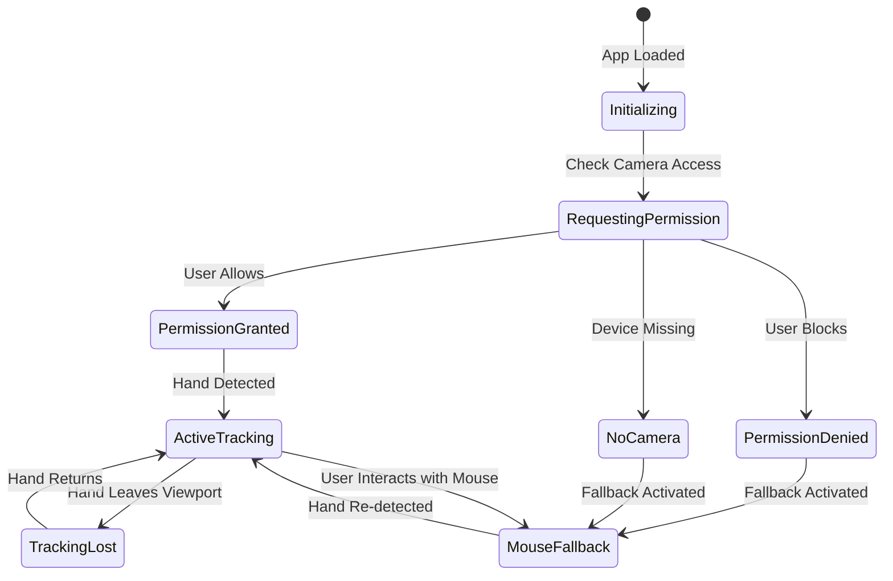

# Visual Design & Interface Specification

## Project: Gesture-Controlled 3D Machine Explorer

---

## 1. Design Principles & Theme

The interface is designed as a **professional engineering inspection tool**. It combines technical precision with unobtrusive interactive overlays:

1. **Content-First (3D Dominant)**: The 3D mechanical model occupies 100% of the viewport. Controls and HUD elements float above the scene with dark glassmorphic styling, avoiding opaque framing that shrinks the canvas.
2. **Immediate Spatial Feedback**: Hand movement must yield immediate visual feedback. A virtual cursor dot reflects pointing position, and hovered parts respond instantly with an emissive highlight.
3. **Calm, High-Contrast Palette**: 
   - *Background*: Deep slate/charcoal (`#0B0F19` to `#111827`) providing rich contrast for 3D metallic and PBR surfaces.
   - *Surface / HUD*: Frosted translucent panels (`rgba(17, 24, 39, 0.75)` with `backdrop-filter: blur(12px)` and subtle borders `rgba(255, 255, 255, 0.1)`).
   - *Accent / Active Tracking*: Precision cyan/teal (`#06B6D4` / `#14B8A6`) signifying active computer vision detection.
   - *Selection / Highlight*: Vibrant amber/gold (`#F59E0B`) highlighting hovered or active mechanical components.
   - *Warning / Error*: Vivid coral/red (`#EF4444`) for permission denial or disconnected hardware.
4. **Ergonomic Respect**: Gesture control can cause arm fatigue ("gorilla arm"). The UI encourages resting poses, provides deadbands to prevent accidental drifts, and guarantees mouse/keyboard access at all times.

---

## 2. Screen Wireframe & Layout

```
┌──────────────────────────────────────────────────────────────────────────────────┐
│  [⚙️ Machine Explorer]  [FPS: 60 | Tracking: 32 FPS]         [Fullscreen] [Reset] │ Top Bar
├──────────────────────────────────────────────────────────────────────────────────┤
│                                                                                  │
│                                                                                  │
│                            [ 3D Mechanical Assembly ]                           │
│                             (Full Viewport WebGL)                                │
│                                                                                  │
│                                            (Cursor: ⦿)                           │
│                                                 │                                │
│                                                 ▼                                │
│                                         [Selected Gear]                          │
│                                      (Emissive Outline)   ┌────────────────────┐ │
│                                                           │ COMPONENT INFO     │ │
│                                                           │ ────────────────── │ │
│                                                           │ Planetary Sun Gear │ │
│                                                           │ Material: AISI 4140│ │
│                                                           │ Teeth: 24 (Mod 2.5)│ │
│                                                           │ Speed: 1,450 RPM   │ │
│                                                           │                    │ │
│                                                           │ [Explode Assembly] │ │
│                                                           │ [Ask AI Explainer] │ │
│                                                           │                    │ │
│                                                           └────────────────────┘ │
│ ┌──────────────────────────┐  ┌────────────────────────────────────────────────┐ │
│ │ Webcam PiP View          │  │ GESTURE CHEAT SHEET                            │ │
│ │ (Mirrored Video +        │  │ 🖐 Open Palm: Rotate  │ ☝ Point: Aim & Hover   │ │
│ │  Landmark Skeleton)      │  │ 🤏 Pinch: Zoom In/Out │ ✊ Fist: Lock / Reset  │ │
│ │ [Hide / Show PiP]        │  │ Active Gesture: [POINTING (94%)]               │ │
│ └──────────────────────────┘  └────────────────────────────────────────────────┘ │
└──────────────────────────────────────────────────────────────────────────────────┘
```

---

## 3. UI Component Details

### 3.1 3D Viewport Canvas
- Occupies $100\text{vw} \times 100\text{vh}$.
- Features subtle studio lighting (directional key light, ambient fill, and subtle rim light).
- Smooth ground grid shadow plane providing spatial depth and scale reference.
- Double-click or scene reset button animates camera back to default isometric viewpoint.

### 3.2 Top Telemetry Bar
- Position: Fixed at top, centered or stretched with padding.
- Displays:
  - Application title & active mechanical model name.
  - Live performance pill: `Render: 60 FPS` | `CV: 30 FPS` | `Status: Live`.
  - Quick action buttons: Camera Reset, Help/Tutorial modal toggle, Fullscreen toggle.

### 3.3 Picture-in-Picture (PiP) Webcam Overlay
- Position: Bottom-left corner ($240\text{px} \times 180\text{px}$).
- Displays:
  - Horizontally mirrored webcam feed.
  - MediaPipe 21-landmark skeleton overlaid in real-time (cyan nodes, white connection lines).
  - Bounding box with handedness label (`Right Hand` / `Left Hand`).
  - Minimize / expand toggle button to reduce distraction once calibrated.

### 3.4 Gesture Quick Guide & Status Bar
- Position: Bottom-center.
- Displays icons and active state for supported gestures:
  - `🖐 Open Palm`: Orbit Scene
  - `☝ Pointing`: Aim & Raycast Hover
  - `🤏 Pinch`: Zoom / Dolly
  - `✊ Fist`: Grip / Reset
- Active gesture indicator highlights with an animated glow badge when detected with $\ge 80\%$ confidence.

### 3.5 Component Information Panel (Right Sidebar)
- Position: Floating right side ($360\text{px}$ width), slide-in upon component selection.
- Displays:
  - Part Name (e.g. `Planetary Sun Gear`, `Main Crankshaft`, `Needle Roller Bearing`).
  - Part Hierarchy (e.g. `Assembly > Transmission > Planetary Stage`).
  - Engineering Specs: Material specification, mass, gear ratio, operational temperature, lubrication interval.
  - Interactive Actions:
    - `Isolate Part`: Fades rest of assembly to 20% opacity.
    - `Exploded View Slider`: Spreads parts outward along primary axis.
    - `Explain with AI` (Future phase): Requests contextual explanation.
  - Close button (`✕`) or click outside to dismiss.

---

## 4. Application States & Edge-Case Handling



### State Specifications:

1. **Loading State**:
   - Clean dark backdrop with a centered spinner and progress message: *"Initializing 3D graphics and vision models..."*
   - Displays animated loading bar while Three.js assets and MediaPipe Wasm bundles initialize.

2. **Camera Permission Request**:
   - Friendly non-intrusive dialog: *"Gesture Explorer requires webcam access to track hand gestures. All processing happens 100% locally on your machine."*
   - Clear *Allow Camera* action button.

3. **Permission Denied / Camera Unavailable**:
   - Non-blocking banner at top-right with an informational icon:
     *"Camera access not granted. Standard mouse & keyboard controls are active."*
   - PiP video box replaced with a subtle graphic indicating *"Mouse Mode Active"*.
   - The user is fully empowered to explore the 3D model using mouse drag (orbit), wheel (zoom), and click (select).

4. **Tracking Lost / Hand Out of Bounds**:
   - The 3D camera does not snap back or jerk. It smoothly decelerates using inertia.
   - The gesture status indicator gently transitions to *"Searching for hand..."* with a subtle pulsing radar animation.

5. **Poor Lighting / Low Confidence Warning**:
   - If tracking confidence drops below 0.6 for $> 2\text{ seconds}$, a discreet pill appears below the PiP box: *"Low lighting or hand partially occluded."*

---

## 5. Accessibility & Usability Considerations

- **Dual Control Modality**: Mouse and keyboard controls remain active in parallel at all times. Users are never trapped in gesture-only mode.
- **Keyboard Shortcuts**:
  - `R`: Reset camera to home view.
  - `M`: Toggle webcam PiP visibility.
  - `Space`: Deselect current component.
  - `F`: Toggle fullscreen.
  - `Escape`: Close modals and inspection panel.
- **High Contrast & Readability**: All text elements satisfy WCAG AA contrast standards ($\ge 4.5:1$) against dark backgrounds.
- **Motion Sensitivity Toggle**: Setting available to reduce or disable smooth inertial dampening for users prone to motion discomfort.

---

## 6. Phase 9 Platform Design: Multi-Model Architecture & CAD Workspace Specification (Task 9.0)

### 6.1 Two-Tier Navigation & View Hierarchy

The platform transitions from a single-model demo into a structured engineering learning environment with two core views:

```mermaid
flowchart LR
    A["Home Catalogue Dashboard (view === 'catalog')"] <-->|"Model Selection / Back Button"| B["CAD-Style Technical Workspace (view === 'workspace')"]
    
    subgraph A ["Home Dashboard"]
        A1["Domain Filter Tabs (All / Mechanical / Civil)"]
        A2["Search Bar & Tag Filters"]
        A3["Featured Model Spotlight Banner"]
        A4["Responsive Model Card Grid"]
    end
    
    subgraph B ["CAD Technical Workspace"]
        B1["Top Workspace Bar (Breadcrumbs, Presets, Exploded Slider, Telemetry)"]
        B2["Left CAD Dock (Assembly Hierarchy Tree & Guided Steps)"]
        B3["Center Viewport (Three.js WebGL Canvas + Gesture Laser Cursor)"]
        B4["Right CAD Dock (Domain-Aware Engineering Inspector)"]
        B5["Bottom Dock (Webcam PiP + Skeleton, Gesture Guide, Input Status)"]
    end
```



---

### 6.2 Home Dashboard Specification (Engineering Explorer)

The dashboard is designed for rapid model discovery, domain filtering, and clear educational onboarding.

```
┌────────────────────────────────────────────────────────────────────────────────────────────────┐
│  [⚙️ Engineering Explorer]   [Domains: All (6) | ⚙️ Mechanical (3) | 🌉 Civil (3)]   [🔍 Search]│
├────────────────────────────────────────────────────────────────────────────────────────────────┤
│  FEATURED ENGINEERING SPOTLIGHT                                                                │
│  ┌───────────────────────────────────────────────────────┬──────────────────────────────────┐  │
│  │ [Interactive 3D Preview: Epicyclic Planetary Gearbox] │ Epicyclic Planetary Stage        │  │
│  │                                                       │ Domain: Mechanical Engineering   │  │
│  │                                                       │ 7 Addressable Parts | Kinematics │  │
│  │                                                       │ Description: High-torque coaxial │  │
│  │                                                       │ planetary reduction mechanism.   │  │
│  │                                                       │ [ 🚀 Launch 3D Workspace ]       │  │
│  └───────────────────────────────────────────────────────┴──────────────────────────────────┘  │
│                                                                                                │
│  ENGINEERING MODEL CATALOGUE                                              [Sort: Complexity ▾] │
│  ┌────────────────────────┐  ┌────────────────────────┐  ┌────────────────────────┐            │
│  │ [Planetary Gearbox]    │  │ [Warren Truss Bridge]  │  │ [Internal Combustion]  │            │
│  │ ⚙️ Mechanical          │  │ 🌉 Civil               │  │ ⚙️ Mechanical          │            │
│  │ 7 Components | Active  │  │ 18 Structural Members  │  │ 4-Stroke Single Cyl.   │            │
│  │ Complexity: Intermed.  │  │ Complexity: Beginner   │  │ Complexity: Advanced   │            │
│  │ Tags: Gears, Torque    │  │ Tags: Truss, Bridge    │  │ Tags: Piston, Crank    │            │
│  │ [Launch Workspace →]   │  │ [Launch Workspace →]   │  │ [Roadmap / Future]     │            │
│  └────────────────────────┘  └────────────────────────┘  └────────────────────────┘            │
│  ┌────────────────────────┐  ┌────────────────────────┐  ┌────────────────────────┐            │
│  │ [Cable-Stayed Pylon]   │  │ [Differential Gear]    │  │ [Retaining Wall]       │            │
│  │ 🌉 Civil               │  │ ⚙️ Mechanical          │  │ 🌉 Civil               │            │
│  │ 12 Cable Pairs         │  │ Automotive Transm.     │  │ Geotechnical Concrete  │            │
│  │ [Launch Workspace →]   │  │ [Roadmap / Future]     │  │ [Roadmap / Future]     │            │
│  └────────────────────────┘  └────────────────────────┘  └────────────────────────┘            │
└────────────────────────────────────────────────────────────────────────────────────────────────┘
```

#### Dashboard UI Elements & Tokens:
1. **Header & Brand Banner**:
   - Title: `Engineering Explorer` with gear/compass icon.
   - Tagline: *"Interactive 3D spatial exploration for mechanical & civil engineering."*
2. **Domain Filter Pills**:
   - Three tab options: `All`, `⚙️ Mechanical`, `🌉 Civil`.
   - Each displays an active item count badge (e.g., `Mechanical (3)`).
   - Style: Border radius 20px; active pill has background `rgba(6, 182, 212, 0.15)` with border `1px solid #06B6D4` and text `#38BDF8`.
3. **Search & Filter Bar**:
   - Real-time text filter matching model title, category, description, and keyword tags.
   - Debounced search (150ms).
   - Clear button (`✕`) when query is present.
   - Empty state: *"No engineering models match your search. Try adjusting domain filter or keyword."*
4. **Featured Model Spotlight Card**:
   - Large banner with two-column split on desktop (interactive/rendered visual on left, engineering summary and CTA on right).
   - Radial gradient backdrop: `radial-gradient(circle at top left, rgba(6, 182, 212, 0.12), transparent 70%)`.
   - Prominent primary CTA: `[ 🚀 Launch 3D Workspace ]`.
5. **Model Catalogue Cards**:
   - Card dimensions: Min-width 280px, responsive CSS grid (`grid-template-columns: repeat(auto-fill, minmax(280px, 1fr))`).
   - Anatomy:
     - 16:9 thumbnail preview container with subtle border.
     - Domain badge pill (`Mechanical` in cyan, `Civil` in amber/emerald).
     - Model title (bold 16px) & category subtitle (13px muted).
     - Key engineering stats (e.g., `7 Addressable Parts`, `Kinematics`, `ISO PBR`).
     - Tags row (e.g., `#Gears`, `#ReductionRatio`, `#Transmission`).
     - Action button: Full-width card launch button (`Launch Workspace →`).

---

### 6.3 CAD-Style Technical Workspace Specification (GestureLab 3D Reference)

The technical workspace follows professional CAD software patterns (dark slate canvas, left hierarchy tree, center 3D viewport, right property inspector, and floating gesture controls).

```
┌────────────────────────────────────────────────────────────────────────────────────────────────┐
│ [← Models]  Mechanical > Transmissions > Planetary Gearbox                [Explode: ──●── 40%] │ Top Bar
│ Camera: [Isometric] [Front] [Top] [Side] │ Render: 60 FPS | Vision: 30 FPS   │ [⛶ Fullscreen]   │ (48px)
├──────────────────────┬───────────────────────────────────────────┬─────────────────────────────┤
│ ASSEMBLY HIERARCHY   │                                           │ COMPONENT INSPECTOR         │
│ ──────────────────── │                                           │ ─────────────────────────── │
│ 🔍 Filter parts...   │         [ 3D WebGL Technical Viewport ]   │ Part: Planetary Sun Gear    │
│ ▼ Planetary Assembly │                                           │ Domain: Mechanical          │
│   ├ 👁 [Sun Gear]     │                      (Laser Pointer ⦿)    │ Hierarchy: Stage > Sun Gear │
│   ▼ 👁 Planet Carrier│                           │               │ Status: Selected (Dwell)    │
│     ├ 👁 Planet A    │                           ▼               │ ─────────────────────────── │
│     ├ 👁 Planet B    │                    [Selected Mesh]        │ [Overview] [Technical Specs]│
│     └ 👁 Planet C    │                   (Emissive Outline)      │                             │
│   ├ 👁 Ring Gear     │                                           │ Teeth: 16 (Module 3.0 mm)   │
│   └ 👁 Central Shaft │                                           │ RPM: 1,200 (Input Direct)   │
│ ──────────────────── │                                           │ Torque: 45.0 N·m            │
│ [Guided Lesson Mode] │                                           │ Material: AISI 4140 Steel   │
│ Step 2 of 4:         │                                           │                             │
│ "Planet Gear Motion" │                                           │ [Isolate] [Focus] [Reset]   │
├──────────────────────┴───────────────────────────────────────────┴─────────────────────────────┤
│ ┌──────────────────────────┐  ┌────────────────────────────────────────────────┐ [Mouse Mode]  │ Bottom Dock
│ │ Webcam PiP + Skeleton    │  │ Active Gesture: ☝ POINTING (96% Confidence)    │ [Gesture Mode]│
│ │ [Hide] [Front Camera]    │  │ 🖐 Orbit  │  🤏 Zoom  │  ☝ Raycast  │  ✊ Lock │ [Keyboard: ?] │
│ └──────────────────────────┘  └────────────────────────────────────────────────┘ ───────────────│
└────────────────────────────────────────────────────────────────────────────────────────────────┘
```

#### Dock Specifications & Functional Anatomy:

1. **Top Workspace Bar (48px height)**:
   - Left section: `[← Models]` return button; hierarchical breadcrumbs (`Mechanical > Transmissions > Planetary Gearbox`).
   - Center section: Camera preset buttons (`[Isometric]`, `[Front]`, `[Top]`, `[Side]`); View options (`[Grid: On]`, `[Wireframe: Off]`).
   - Right section: Exploded view slider (`0%` to `100%`); live telemetry pill (`Render: 60 FPS | Vision: 30 FPS`); fullscreen toggle button (`⛶`).

2. **Left CAD Dock: Assembly Hierarchy & Guided Curriculum (280px width, collapsible)**:
   - Header with dock collapse button (`◀`), title `Assembly Hierarchy`, and search input (`🔍 Filter parts...`).
   - **Tab 1: Assembly Tree**:
     - Nested collapsible tree nodes with expansion carets (`▼` / `▶`).
     - Per-node visibility toggle eye icon (`👁`). Toggling eye hides/shows mesh in 3D viewport without breaking selection.
     - Active selection highlight (cyan outline + subtle cyan background tint).
     - Hover synchronization: Moving gesture laser or mouse over tree item highlights the corresponding mesh in 3D scene.
   - **Tab 2: Guided Curriculum**:
     - Step-by-step engineering lessons (e.g. Step 1: Input Shaft & Sun Gear $\to$ Step 2: Epicyclic Planet Rotation $\to$ Step 3: Carrier Output Torque).
     - Lesson navigation (`[Previous Step]` / `[Next Step]`).

3. **Center 3D Technical Viewport (Flex-1)**:
   - Full WebGL canvas rendering the active assembly with PBR studio lighting.
   - Spatial scale ground grid with subtle coordinate reference marks.
   - 3D orientation triad gizmo (X-red, Y-green, Z-blue) in corner.
   - Emissive component hover highlighting (gold/cyan emissive tint without mutating shared materials).
   - Real-time Virtual Laser Cursor dot and circular dwell progress ring tracking fingertip raycast.

4. **Right CAD Dock: Engineering Inspector (320px width, collapsible)**:
   - Header with component name, close/deselect button (`✕`), and ID tag pill.
   - Tab 1: *Overview*: Functional role, description, and key engineering highlights.
   - Tab 2: *Technical Specs*: Formatted data table of dimensions, kinematics, or structural parameters.
   - Tab 3: *Materials & Properties*: Material alloy, hardness, treatment, and lubrication specs.
   - Action buttons:
     - `[Isolate Component]`: Fades unselected components to 15% opacity.
     - `[Focus Camera]`: Smoothly pans and zooms camera to frame selected part.
     - `[Clear Selection]`: Deselects part and closes dock.

5. **Bottom Gesture-Control Dock**:
   - Bottom-left: Webcam PiP ($220\text{px} \times 165\text{px}$) with mirrored video feed, 21-landmark skeleton, and minimize toggle.
   - Bottom-center: Gesture Cheat Sheet showing active posture badge with confidence % (`☝ POINTING (96%)`) and action mappings (`🖐 Orbit`, `🤏 Zoom`, `☝ Raycast`, `✊ Lock`).
   - Bottom-right: Input arbitration pill showing active control modality (`[Gesture Active]` vs `[Mouse Override Active]`).

---

### 6.4 Visual System: Tokens, Typography, Components & States

#### 6.4.1 Color Palette & Design Tokens
```css
:root {
  /* Surface & Background */
  --bg-app: #0B0F19;               /* Deep slate viewport backdrop */
  --bg-surface: #111827;           /* Card & dock background */
  --bg-surface-elevated: #1F2937;  /* Hover / dropdown surface */
  --bg-dock-glass: rgba(17, 24, 39, 0.78); /* Translucent CAD dock */
  --dock-backdrop-blur: 12px;

  /* Borders & Dividers */
  --border-subtle: rgba(255, 255, 255, 0.08);
  --border-medium: rgba(255, 255, 255, 0.16);
  --border-accent: rgba(6, 182, 212, 0.50);

  /* Accents & Signals */
  --accent-cyan: #06B6D4;          /* Computer vision & active tracking */
  --accent-cyan-hover: #0891B2;
  --accent-teal: #14B8A6;          /* Success & secondary highlights */
  --accent-amber: #F59E0B;         /* Component selection highlight */
  --accent-amber-glow: rgba(245, 158, 11, 0.25);
  --accent-danger: #EF4444;        /* Permission denial / error */
  --accent-success: #10B981;       /* Camera live / calibrated */

  /* Text & Hierarchy */
  --text-primary: #F9FAFB;         /* High-contrast headings and labels */
  --text-secondary: #9CA3AF;       /* Body copy and subtitles */
  --text-muted: #6B7280;           /* Captions and disabled labels */
  --text-accent: #38BDF8;          /* Clickable links and active states */
}
```

#### 6.4.2 Typography Hierarchy
- **Primary UI Font Stack**: `'Inter', -apple-system, BlinkMacSystemFont, 'Segoe UI', Roboto, sans-serif`.
- **Technical & Telemetry Monospace**: `'JetBrains Mono', 'Fira Code', 'SF Mono', Consolas, monospace`.
- **Scale**:
  - `Display / Hero Title`: 24px (1.5rem), line-height 32px, font-weight 700.
  - `Section / Modal Header`: 18px (1.125rem), line-height 24px, font-weight 600.
  - `Dock Header / Subtitle`: 14px (0.875rem), line-height 20px, font-weight 600, uppercase letter-spacing 0.05em.
  - `Body Copy`: 14px (0.875rem), line-height 20px, font-weight 400.
  - `Metadata / Spec Label`: 12px (0.75rem), line-height 16px, font-weight 500.
  - `Telemetry / Monospace Pill`: 11px (0.6875rem), line-height 14px, font-weight 600.

#### 6.4.3 Spacing & Layout Rhythm
- Grid baseline: 4px.
- Spacing steps: `4px` (xs), `8px` (sm), `12px` (md), `16px` (lg), `20px` (xl), `24px` (2xl), `32px` (3xl).
- CAD dock padding: 16px horizontal, 12px vertical.

#### 6.4.4 Component States & Micro-Interactions
- **Buttons**:
  - *Primary*: Background `linear-gradient(135deg, #06B6D4, #0891B2)`, text `#0B0F19`, font-weight 600, border-radius 6px.
  - *Secondary / Toolbar*: Background `rgba(31, 41, 55, 0.8)`, border `1px solid var(--border-subtle)`, text `#E5E7EB`.
  - *Icon Button*: 32px $\times$ 32px, centered icon, hover background `rgba(255, 255, 255, 0.08)`.
- **States**:
  - *Default*: Border `var(--border-subtle)`.
  - *Hover*: Border `var(--border-accent)`, translateY(-1px), transition `all 150ms ease`.
  - *Active (Pressed)*: Transform `scale(0.98)`.
  - *Selected (Component / Tree Node)*: Border `var(--accent-amber)`, box-shadow `0 0 12px var(--accent-amber-glow)`.
  - *Focus Visible*: High-contrast outline `2px solid #06B6D4`, outline-offset `2px`.
  - *Disabled*: Opacity 0.45, cursor `not-allowed`.

---

### 6.5 Interaction Workflows & State Transitions

```
1. Model Selection & Workspace Entry
   User clicks "Launch Workspace" on Model Card
   ├── View state transitions: 'catalog' → 'workspace'
   ├── ModelRegistry instantiates selected model
   ├── ViewerCanvas mounts 3D scene & applies model-specific camera presets
   └── Top bar breadcrumbs update: [Domain > Subsystem > Model]

2. Bidirectional Component Selection (3D Scene ⇄ Assembly Tree)
   Path A (3D Viewport Raycast / Dwell / Click):
   ├── User hovers pointer or index finger over mesh
   ├── ComponentRaycaster applies non-destructive emissive highlight
   ├── ComponentSelector completes 1.2s dwell timer or mouse click
   ├── Left Assembly Tree auto-expands and highlights the selected node
   └── Right Engineering Inspector slides open with component specifications

   Path B (Assembly Tree Selection):
   ├── User clicks item in Assembly Tree
   ├── ViewerCanvas highlights corresponding 3D mesh with emissive glow
   └── Right Engineering Inspector displays matching component metadata

3. Component Isolation Workflow
   User clicks "Isolate Component" in Inspector
   ├── Unselected meshes transition to 15% opacity (opacity tween: 200ms)
   ├── Selected mesh remains 100% opaque
   └── Action button flips to "Show All Components" to restore assembly opacity

4. Camera View & Reset Workflow
   User clicks preset (e.g. "Isometric", "Front") or presses 'R'
   ├── CameraController smoothly interpolates position & target (damping: 0.05)
   └── Prevents instant camera snapping or disorientation

5. Return to Catalogue Workflow
   User clicks "← Models" in top bar
   ├── ViewerCanvas invokes model-specific dispose() lifecycle
   ├── Model-owned geometries, materials, and textures are explicitly freed
   ├── Animation callbacks and event listeners are cleanly detached
   └── View state transitions back to 'catalog'
```

---

### 6.6 Responsive Behavior & Viewport Breakpoints

| Breakpoint Range | Layout Mode | Left Dock (Tree) | Center 3D Canvas | Right Dock (Inspector) | Bottom Dock |
| :--- | :---: | :---: | :---: | :---: | :---: |
| **Large Desktop ($\ge 1280\text{px}$)** | Full CAD Studio | 280px fixed dock | Flex-1 full viewport | 320px fixed dock | PiP (220x165) + cheat sheet |
| **Medium / Laptop ($1024\text{px} - 1279\text{px}$)** | Collapsible Drawers | Overlay drawer (toggle) | 100% width viewport | Overlay drawer (toggle) | PiP (180x135) + cheat sheet |
| **Small / Tablet ($< 1024\text{px}$)** | Single Pane Tabbed | Fullscreen tab | Fullscreen tab | Fullscreen tab | Bottom navigation bar |

- **Virtual Cursor Viewport Clamping**: When left or right docks collapse or expand, the 3D canvas `clientWidth` and `clientHeight` change dynamically. The `projectFingertipToScreen` utility maps normalized coordinates directly to the canvas bounding client rect, preventing cursor offset errors during dock animations.

---

### 6.7 Accessibility & Non-Gesture Alternatives

1. **Dual-Modality Guarantee**: Every action achievable through gestures (`Orbit`, `Zoom`, `Raycast`, `Dwell Selection`) has an exact mouse and keyboard equivalent.
2. **Keyboard Navigation & Focus Management**:
   - `Tab` / `Shift+Tab`: Cycles through top toolbar actions, assembly tree items, and inspector tabs.
   - `Arrow Up` / `Arrow Down`: Navigates up and down the active Assembly Tree.
   - `Enter` / `Space`: Confirms component selection in tree or opens action item.
   - `Escape`: Deselects active component and closes open inspector/modals.
   - `1` / `2` / `3` / `4`: Quick switches camera presets (Isometric, Front, Top, Side).
   - `R`: Resets camera to default orientation.
   - `E`: Toggles exploded view slider.
   - `M`: Toggles webcam PiP visibility.
3. **Screen Reader & ARIA Semantics**:
   - Assembly tree uses `role="tree"` and `role="treeitem"` with `aria-expanded` and `aria-selected`.
   - Domain filter tabs and inspector tabs use `role="tablist"` and `role="tab"`.
   - All icon buttons include descriptive `aria-label` and `title` attributes (e.g., `aria-label="Toggle component visibility [Sun Gear]"`).
   - Visible focus indicator: High-contrast cyan outline (`2px solid #06B6D4`, offset `2px`).

---

### 6.8 Existing Code Reuse & Integration Map

The Phase 9 multi-model platform integrates our existing verified assets without rewriting:
1. **Planetary Gearbox Assembly**: [PlanetaryGearbox.ts](file:///c:/Users/munir/Music/folder1/CV_3D_GESTURE/frontend/src/components/scene/PlanetaryGearbox.ts) and [machineMetadata.ts](file:///c:/Users/munir/Music/folder1/CV_3D_GESTURE/frontend/src/data/machineMetadata.ts) will be registered as Model `#1` in `ModelRegistry` under the Mechanical Engineering category.
2. **Gesture Interaction Stack**: [gestureRules.ts](file:///c:/Users/munir/Music/folder1/CV_3D_GESTURE/frontend/src/services/gestures/gestureRules.ts), [useGestureStateMachine.ts](file:///c:/Users/munir/Music/folder1/CV_3D_GESTURE/frontend/src/services/gestures/useGestureStateMachine.ts), [useCamera.ts](file:///c:/Users/munir/Music/folder1/CV_3D_GESTURE/frontend/src/hooks/useCamera.ts), [useHandLandmarker.ts](file:///c:/Users/munir/Music/folder1/CV_3D_GESTURE/frontend/src/services/tracking/useHandLandmarker.ts), and [GestureCameraController.tsx](file:///c:/Users/munir/Music/folder1/CV_3D_GESTURE/frontend/src/components/scene/GestureCameraController.tsx) operate identically across any model loaded into the scene.
3. **Raycast & Selection Engines**: [ComponentRaycaster.ts](file:///c:/Users/munir/Music/folder1/CV_3D_GESTURE/frontend/src/components/scene/ComponentRaycaster.ts) and [ComponentSelector.ts](file:///c:/Users/munir/Music/folder1/CV_3D_GESTURE/frontend/src/components/scene/ComponentSelector.ts) query tagged meshes regardless of mechanical or civil domain.
4. **Telemetry Service**: [telemetry.ts](file:///c:/Users/munir/Music/folder1/CV_3D_GESTURE/frontend/src/utils/telemetry.ts) logs rendering FPS, tracking FPS, and glass-to-mesh latency to monitor performance against benchmark targets ($\ge 60\text{ FPS}$ render, $\ge 30\text{ FPS}$ tracking, $< 30$ draw calls).

