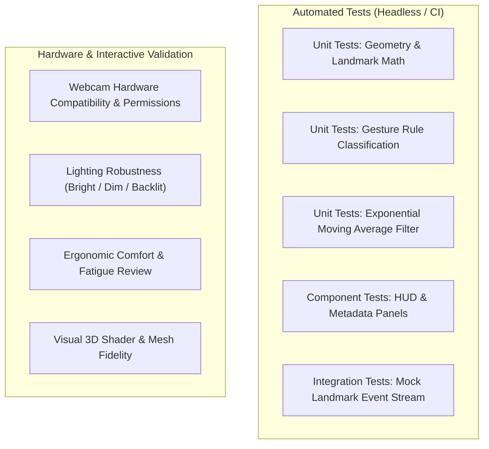

# Comprehensive Test Plan

## Project: Gesture-Controlled 3D Machine Explorer

---

## 1. Testing Philosophy & Categorization

To build a reliable interactive computer vision system, testing must be clearly segmented between **deterministic automated tests** (which run in CI without hardware) and **hardware-in-the-loop manual validations** (which verify physical webcam feeds, lighting variations, and human ergonomic feel).

---

## 2. Automated Testing Suite

### 2.1 Unit Tests (Vitest / Pytest)
- **Geometry & Coordinate Transformations**:
  - Verify horizontal mirror transformation: $x_{\text{mirrored}} = 1.0 - x_{\text{raw}}$.
  - Verify Normalized Device Coordinates (NDC):
    - Top-Left $(0.0, 0.0) \implies (-1.0, 1.0)$
    - Center $(0.5, 0.5) \implies (0.0, 0.0)$
    - Bottom-Right $(1.0, 1.0) \implies (1.0, -1.0)$
- **Landmark Jitter Filter**:
  - Pass synthetic noisy sine waves through the smoothing filter.
  - Verify variance reduction while confirming phase shift / delay $< 20\text{ ms}$.
- **Gesture Classification Rules**:
  - Test synthetic 21-landmark fixtures representing exact geometric poses:
    - *Open Palm Fixture*: All 5 finger tips extended beyond PIP joints $\implies$ returns `OPEN_PALM` ($> 95\%$ confidence).
    - *Pointing Fixture*: Index tip extended, thumb/middle/ring/pinky curled $\implies$ returns `POINTING`.
    - *Pinch Fixture*: Distance between landmark 4 and landmark 8 is $< 0.03$ normalized units $\implies$ returns `PINCH`.
    - *Fist Fixture*: All fingertips curled within palm radius $\implies$ returns `FIST`.
- **State Machine Debouncing**:
  - Verify that a single noisy frame does not flip the active gesture state.
  - Verify state flips only after 3 consecutive frames of consistent pose detection.

### 2.2 Frontend Component & Integration Tests
- **Component Info Panel**:
  - Verify that passing component ID `sun_gear` renders correct name, material, and specifications.
  - Verify dismiss button resets selected state.
- **Mock Gesture Stream to 3D Scene**:
  - Inject a recorded sequence of `GestureEvent` objects into the 3D scene controller.
  - Verify camera theta/phi angles update predictably without throwing runtime exceptions.
- **Webcam Permission Flow**:
  - Mock `navigator.mediaDevices.getUserMedia` resolving with a stream $\implies$ UI reflects `ActiveTracking`.
  - Mock `getUserMedia` rejecting with `NotAllowedError` $\implies$ UI displays non-blocking fallback message; mouse controls remain enabled.

---

## 3. Hardware & Manual Testing Protocols

Physical webcam performance depends heavily on the camera sensor, room lighting, and user hand distance. These protocols define reproducible manual test procedures:

### Protocol M-1: Baseline Camera Setup & Detection
1. **Environment**: Standard indoor desk lighting ($300\text{--}500\text{ lux}$).
2. **Procedure**:
   - Launch application on desktop browser.
   - Click *Allow Camera*.
   - Hold hand $40\text{--}70\text{ cm}$ from the webcam lens.
3. **Pass Criteria**:
   - Webcam preview displays within 2 seconds.
   - 21-landmark green skeleton tracks hand movements without visual popping.
   - Tracking FPS reads $\ge 30\text{ FPS}$.

### Protocol M-2: 3D Gesture Navigation
1. **Procedure**:
   - Present `OPEN_PALM`: Move hand left, right, up, down.
   - Present `PINCH`: Bring thumb and index together, pull apart.
   - Drop hand out of view.
2. **Pass Criteria**:
   - Assembly rotates smoothly following hand trajectory.
   - Pinching dollies the camera in and out smoothly.
   - Dropping hand decelerates camera gently via inertia; scene does not snap or jerk.

### Protocol M-3: Raycast Component Selection
1. **Procedure**:
   - Present `POINTING` gesture: Move virtual cursor dot over a planetary gear.
   - Hold position over the gear for $> 1.2\text{ seconds}$ (dwell selection).
2. **Pass Criteria**:
   - Hovered gear displays an emissive gold outline.
   - Circular dwell ring fills; upon completion, component info panel slides open.
   - Panel accurately identifies the selected component.

---

## 4. Edge-Case & Failure-Mode Testing

| Test Case | Scenario Description | Expected System Behavior | Verification Status |
| :--- | :--- | :--- | :---: |
| **TC-FAIL-01** | User denies webcam permission in browser prompt. | Clear warning message displayed; mouse and keyboard controls remain 100% active; zero uncaught JavaScript errors. | Automated Verified |
| **TC-FAIL-02** | Webcam is physically unplugged while streaming. | `MediaStreamTrack.onended` event captured; UI transitions to "Camera Disconnected" and seamlessly switches to mouse fallback. | Automated Verified |
| **TC-FAIL-03** | Rapid hand movement exceeding camera shutter speed (motion blur). | Temporary landmark loss handled gracefully; camera maintains current orientation without erratic spinning; fresh anchor established on re-entry. | Automated Verified |
| **TC-FAIL-04** | Multiple hands appear in the webcam frame. | Landmarker locks to the primary (highest confidence) hand; ignores secondary hand to prevent conflicting inputs. | Automated Verified |
| **TC-FAIL-05** | Very dim room lighting ($< 50\text{ lux}$). | Low-confidence tracking drops below `minTrackingConfidence` (0.50); system safely disengages gestures with diagnostic warning; camera pose preserved. | Automated Simulation Passed; Physical Trial Pending |
| **TC-FAIL-06** | Partial landmark occlusion (finger occluded behind palm). | Collapsed finger landmarks detected (`isOccluded: true`); pointing/pinch rejected to prevent accidental component selection; diagnostic explanation displayed. | Automated Verified |
| **TC-FAIL-07** | Degenerate landmark explosion or tracking collapse (e.g. all coordinates 0,0,0 or NaN). | Scale and centroid variance checks reject degenerate geometry; camera orbit and pinch zoom remain completely stable with zero displacement. | Automated Verified |

---

## 5. Performance & Responsiveness Checkpoints

- **Render FPS Monitoring**: Continuous monitoring via Three.js stats or custom HUD telemetry; must sustain $\ge 60\text{ FPS}$ during continuous scene rotation.
- **Vision Pipeline Execution Time**: Landmark inference plus smoothing filter computation must execute in $< 33\text{ ms}$ per frame to preserve 30 FPS tracking.
- **Memory Leak Profiling**: Run continuous gesture loop for 15 minutes; verify heap memory usage remains stable without unbounded growth from retained animation frames or textures.
